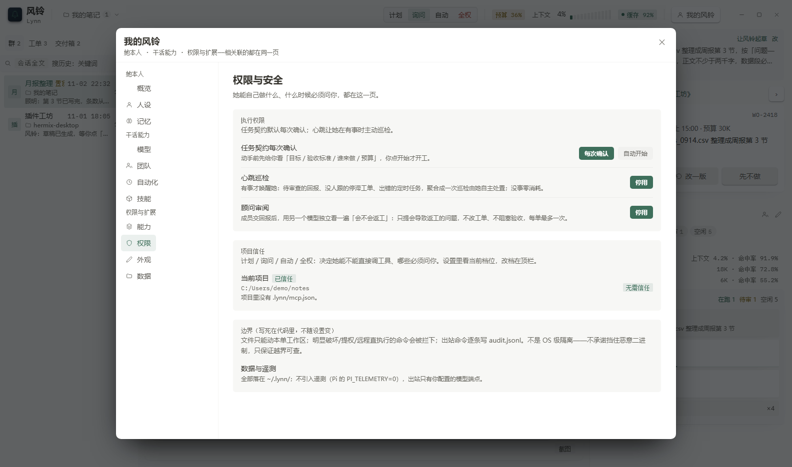

<p>
  
</p>

# 风铃 Lynn

**每个人都该有一只自己的风铃。** *A Lynn of your own.*

本地优先的桌面 AI **指挥助理**：她不亲自干活，而是组队、派单、盯进度、核对证据、向你汇报。
Electron + TypeScript，Windows 优先；数据全部留在本机 `~/.lynn/`。


## 一眼看懂

| | |
|---|---|
| **她是指挥者** | 风铃只派单与验收；成员在各自工作区执行，产出落盘才收回报 |
| **卷宗** | 每张工单有 `timeline` / `artifacts` / `evidence`；交付物永久保留，过程证据只登记 |
| **审批** | 删除、改名等危险操作弹卡等你点头，可按「族」长期放行 |
| **双运行路径** | Pi RPC 独立进程（默认）与直连 SSE（降级）；切换模型不必换会话 |
| **本地优先** | API Key 由系统 `safeStorage` 加密；成员命令环境会剔除凭据变量 |

## 快速开始

要求 Node 22+（建议 22.12 以上）。

```bash
npm ci
npm run build   # typecheck + renderer(vite) + main(tsc)
npm start       # electron .
```

首次启动点右上角 ⚙ 填 **Base URL / API Key / 模型**，可先「测试连接」再保存。

> 想直接看界面而不接模型：`npm run build:renderer && npm run shot -- shots/desk.png`（走查用假桥数据）。

## 验证链

```bash
npm run verify          # typecheck → oxlint → lint:design → 724 条 node --test
npm run lint            # oxlint，基线 0 warning / 0 error
npm run build:main      # 主进程 CJS 产物
npm run build:renderer  # vite 产物
```

三个**真实**对照探针会调用已配置的模型（少量 token，结果写入被 gitignore 的 `shots/*.json`）：

| 命令 | 验证什么 |
|---|---|
| `npm run probe:usage` | 7 个已配置模型的最小探针 + 前缀 A/B 对照，看各端点回报哪些缓存字段 |
| `npm run probe:pi` | 真 `Kernel` + 真 Pi 子进程跑 6 轮，验证「改公告不断前缀、改 system 内容立刻断」 |
| `npm run probe:ui` | 真 Electron 窗口里点输入框发两轮消息，验证卡片、用量落盘与缓存徽章 |

实测结论见 [`docs/token-cache-audit-lynn.md`](./docs/token-cache-audit-lynn.md)：Pi 路径下改群公告命中率维持 94.7–98.1%，改 system 内容掉到 0–3.4%。

## 打包

```bash
npm run dist   # electron-builder --win → release/Lynn-0.0.1-setup.exe（NSIS）
```

本机两个注意点：electron-builder 会先清空旧的 `win-unpacked`，文件数超过本机 safe-delete 阈值时要输出到**全新目录**；GitHub release 下载不稳定时可用 `electronDist: node_modules/electron/dist` 直接复制本地 Electron。安装包目前**未做代码签名**。

## 结构（2026-11-15）

```
src/
├── shared/
│   ├── contract.ts        # 类型化 IPC 契约（RPC + 事件流，唯一契约）
│   ├── i18n-strings.ts    # 中英字典；派生的 I18nKey 让 t() 拼错就编译报错
│   └── magic-words.ts     # ultrathink / chillax / orchestrate，只影响当轮
├── main/
│   ├── main.ts            # Electron 薄壳：窗口 / IPC / safeStorage / 托盘
│   ├── kernel.ts          # 内核编排（8079 行；热点 RPC 已拆成命名方法）
│   ├── rpc/               # 数据面 RPC：settings-rpc.ts / thread-rpc.ts
│   ├── member-runner.ts   # 成员执行循环 + 工具白名单 + 回报校验（含 checks）
│   ├── toolkit.ts         # 路径钉扎 / unified diff / 分页读 / grep / 命令执行
│   ├── advisor.ts         # 独立模型审阅：三档 severity + 空话过滤 + 去重预算
│   ├── cmd-env.ts         # 命令环境白名单 + 非交互加固 + PATH 前置 POSIX 工具
│   ├── cmd-output.ts      # execa 原始 Buffer → GBK 兜底 → head+tail 保 stderr
│   ├── pdf-text.ts        # pdfjs-dist 提文本（扫描件如实说提不出来）
│   ├── budget.ts / cleanup.ts / memory.ts / settings.ts / …
├── renderer/desk/         # 值台：Desk.tsx(401 行) + 9 个面板文件
│   ├── Ledger.tsx  Sheet.tsx  Roster.tsx  Composer.tsx
│   ├── Seals.tsx   Menus.tsx  Review.tsx  Palette.tsx  TopRail.tsx
│   └── model.ts / use-tick.ts
├── renderer/boot/
│   └── BootScreen.tsx     # 启动页：字距收拢 + 真实快照进度条
scripts/
│   ├── shots/*.cjs        # 44 个走查模式（注册表，主文件 297 行）
│   ├── make-icon.py       # 图标生成（几何切角 L，纯 Pillow）
│   ├── shot-boot.cjs      # 启动页走查截图
│   └── live-*probe*.cjs   # 真模型 / 真 Pi / 真 UI 对照探针
tests/                     # 724 条 node --test（含整链路模拟任务）
```

拆分划线原则：**按数据面 / 编排面拆，不按方法数量拆**。`task.*` 依赖 22 个成员（含可变状态集合），留在 kernel 里只做薄转发，避免状态所有权分裂。

## 图标与启动页

`build/icon.ico` 是含 **16 / 24 / 32 / 48 / 64 / 128 / 256 七帧**的真位图图标（不是 SVG）。字母是**几何构造**出来的，不是排版字体：

- 所有外凸角统一 45° 切角，字母撑到版面边缘；内凹角不切，保住 L 的结构
- 只用两个 token：底 `--desk #0a0d0f`、形 `--ink #e6ebee`，**零功能色**（黄铜是预算语义、青瓷是结构语义，都不当品牌主色）
- ≤64px 单独一版：切角比例放大到 10%、笔画加粗、留白收窄，16px 才认得出
- 托盘 `assets/tray.png`、`tray-icon.ts` 的 base64 兜底、窗口/安装包、顶栏标记（`clip-path` 用同一组坐标）、`public/favicon.ico` **全部同源**（一次定义、四处复用）


启动页 `BootScreen.tsx` 按 C 方案：字距 28px→0 收拢 680ms，底部 2px 进度线由 `session.snapshot` **真实就绪**驱动（0→90% 后停住等，就绪才补满并淡出交接）。画面固定夜航底色，不随亮/暗主题变；遵守 `prefers-reduced-motion`。走查时用 `?boot=1` 让启动页常驻：

```bash
npm run build:renderer && npx electron scripts/shot-boot.cjs
```

重做图标：`python scripts/make-icon.py`（Pillow + fontTools/brotli）。


## 这一轮加固了什么

| 面 | 落地 |
|---|---|
| 正确性 | 命令环境剔密钥、RPC 契约 ↔ 实现双向 parity 测试、i18n key 编译期校验、`readUsage(0)` 等边界修复 |
| 成本 | 缓存分层（易变事实移出 system prompt）、启动两段化、oxlint 清零 |
| 工具面 | `edit_file` 支持 unified diff、`read_file` 按行分页、`grep` include/大小写/上限、PDF 读取、`list_dir` 带大小时间 |
| 执行面 | `execa` + GBK 解码 + stderr 尾部保留 + 超时强杀 + 「停」真杀进程、`usage.jsonl` 轮转 |
| 能力 | 魔法词、顾问第二模型 + 模型角色表、成员回报 `checks[]`、骨架稿拦截、项目级记忆、审批族长期放行 |
| 可观测 | Pi 路径按次台账、`cacheFieldsReported`、成员台账、`cacheBreakReason`，三个真模型探针 |
| 结构 | `Desk.tsx` ~5030 → **401** 行、`kernel.ts` 抽出 RPC 子模块、`preview-shot.cjs` 1205 → **297** 行 |
| 品牌 | 图标配色回到项目 token、Archivo 字标、托盘/窗口/安装包/顶栏/favicon 同源、启动页 C 方案落地 |



## 设计基线

- 三栏不对等、**零卡片描边**、四功能色（`--blue` 结构 / `--seal` 等你拍板 / `--red` 打回 / `--brass` 预算）；`npm run lint:design` 把关。
- 中英 i18n 全量 key 化，调用点由 `I18nKey` 编译期约束。
- 命令执行面不自己造轮子：`diff`(BSD-3) / `execa`(MIT) / `iconv-lite`(MIT) / `pdfjs-dist`(Apache-2.0) / `oxlint`(dev, MIT)。
- CI：`.github/workflows/ci.yml` → `windows-latest` + Node 22 + `npm ci && npm run verify`。

## 文档

| 文档 | 管什么 |
|---|---|
| [`docs/site/zh/`](./docs/site/zh/) · [`en/`](./docs/site/en/) | 用户与插件开发者文档站：快速开始 / 插件指南 / 索引 / 隐私 / 发布签名 |
| [`docs/token-cache-audit-lynn.md`](./docs/token-cache-audit-lynn.md) | 用量与缓存实测报告（含真 Pi、真 UI 对照与仍存缺口） |
| [`docs/notes/`](./docs/notes/) | 仍有效的架构决策记录与历史评测报告 |
| [`docs/archive/`](./docs/archive/) | 已落地 / 过期的历史提案（不再作为现状依据） |
| [`PLUGIN-CONTRACT.md`](./PLUGIN-CONTRACT.md) | UI 插件契约 v1（卡槽语义 + iframe 沙箱） |
| [`THIRD_PARTY_NOTICES.md`](./THIRD_PARTY_NOTICES.md) | 第三方声明（`node scripts/gen-notices.mjs` 再生） |

## 数据与隐私

- 数据根 `~/.lynn/`（可用 `LYNN_HOME` 覆盖）：设置、会话、工单卷宗、团队、插件、日志。
- API Key 由系统 `safeStorage` 加密；成员命令环境剔除变量名含 `KEY/TOKEN/SECRET/PASS…` 的值。
- 卸载默认**不删数据**（`deleteAppDataOnUninstall: false`）；交接机器前请手动删除 `~/.lynn/settings.json`。
- 安装包目前**未做 Windows 代码签名**，详见 [`docs/site/zh/release.md`](./docs/site/zh/release.md)。

## 已知边界

- 命令侧路径校验是启发式，挡不住变量拼接与脚本内读写，**不是 OS 级沙箱**。
- 消息平台只发不收（长连接未接）。
- `cost` 恒 0（未接 provider 定价）、无响应缓存，重复问同一句仍全额重算。
- Windows 代码签名未接入；macOS `icns` 图标未生成。

## 许可

MIT · [`LICENSE`](./LICENSE)
